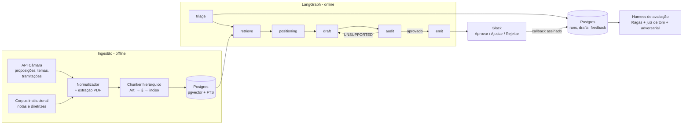

# RIG Intelligence Engine

**Um radar legislativo com rastro de evidência: transforma proposições da Câmara dos Deputados em posicionamento institucional auditável, com revisão humana no meio do caminho.**

> Status: **spec** (F0 não iniciado). Números de avaliação só entram aqui depois de medidos — este README não publica métrica estimada.

---

## O problema

Uma área de Relações Institucionais e Governamentais no Brasil lê, por ano, algo entre 4 e 6 mil proposições na Câmara. A triagem é manual e reativa: descobre-se o PL relevante quando alguém manda o link no grupo, ou quando o setor já foi impactado. Depois disso, produzir uma nota técnica leva de 4 a 8 horas de um especialista sênior — tempo que deveria estar em negociação política, não em formatação de texto.

O gargalo não é escrever. É **saber o que importa** e **provar por que importa** antes de escrever.

## O que este projeto faz

```
Câmara API ──► Radar (triagem)  ──► Contexto (RAG)  ──► Minuta (redação)  ──► Auditoria  ──► Revisor humano
               5.000 → 20            posições e          nota técnica         claim a claim     Aprovar/Ajustar/Rejeitar
               com justificativa      diretrizes         com citações         contra a fonte
```

Cinco garantias que o sistema se compromete a cumprir — e que são testadas, não prometidas:

| Garantia | Como é verificada |
|---|---|
| **Toda afirmação tem lastro** | Cada frase factual carrega `[C<n>]` apontando para um chunk de fonte; um verificador por sentença emite `SUPPORTED / PARTIAL / UNSUPPORTED / CONTRADICTED`. Claim sem lastro bloqueia a emissão. |
| **Número e artigo conferem literalmente** | Datas, valores e referências a artigos são extraídos dos dois lados e comparados por igualdade de string — não por "parece certo". |
| **O sistema recusa** | Suíte adversarial: pedir um artigo que não existe, um parecer jurídico, ou uma posição que contraria diretriz interna → resposta obrigatória é recusa explícita, não texto plausível. |
| **A triagem é barata e explicável** | Pré-filtro determinístico (mapa de mandato) reduz o universo; o LLM só opina sobre o shortlist, devolvendo os trechos que justificam o score. |
| **O revisor melhora o sistema** | Rejeição e ajuste no Slack viram `FeedbackEvent` com diff; o diff alimenta o golden set e as instruções de reparo da próxima geração. |

## O que este repositório **não** é

- Não é um `CrewAI quickstart` com três PDFs inventados. Todo o corpus é real: proposições e inteiro teor da API de Dados Abertos da Câmara, notas técnicas públicas de consultorias legislativas e de entidades setoriais.
- Não é um gerador de texto livre. O produto é um **funnel com portão de auditoria**; texto sem evidência não sai.
- Não publica número que não tenha sido medido. Enquanto a fase F5 não roda, as tabelas de resultado ficam vazias de propósito.

## Arquitetura em uma tela



Decisões de arquitetura com o porquê: [`docs/09-decisions.md`](docs/09-decisions.md).

## Documentação

| Documento | Conteúdo |
|---|---|
| [`docs/00-vision.md`](docs/00-vision.md) | Personas, jobs-to-be-done, escopo e não-escopo, perfil de empresa demonstrativo |
| [`docs/01-architecture.md`](docs/01-architecture.md) | Componentes, fluxo, pontos de falha, o que acontece quando o LLM erra |
| [`docs/02-data.md`](docs/02-data.md) | Contratos reais da API da Câmara, chunking jurídico, versionamento do corpus |
| [`docs/03-agents.md`](docs/03-agents.md) | Grafo, estado tipado, prompts, orçamento de tokens, guardrails |
| [`docs/04-hitl.md`](docs/04-hitl.md) | Slack, máquina de estados da minuta, contrato do feedback |
| [`docs/05-evaluation.md`](docs/05-evaluation.md) | Golden set, métricas, thresholds de CI, suíte adversarial |
| [`docs/06-kpis.md`](docs/06-kpis.md) | KPIs de produto e de negócio, o que é medido e como |
| [`docs/07-roadmap.md`](docs/07-roadmap.md) | Fases F0–F6, critérios de pronto por fase |
| [`docs/08-failures.md`](docs/08-failures.md) | Registro de falhas reais encontradas e como foram fechadas |
| [`docs/golden-set/README.md`](docs/golden-set/README.md) | Protocolo de rotulagem da amostra de 120 proposições |

## Stack

`Python 3.11+` · `LangGraph` · `Pydantic v2` (strict) · `FastAPI` (async) · `Postgres 16` + `pgvector` + FTS português · `sentence-transformers` (cross-encoder local para rerank) · `Gemini Flash` para iteração, modelo forte só na redação final · `Ragas` + juiz de tom próprio · `Docker Compose` · `pytest` com LLM mockado · `ruff` + `mypy --strict` · `uv`

## Como rodar

Ainda não implementado (F0 é a próxima fase). O alvo é:

```bash
cp .env.example .env      # GEMINI_API_KEY, SLACK_*, DATABASE_URL
docker compose up -d      # postgres+pgvector, api, worker
make ingest               # baixa e indexa o corpus real
make demo                 # PL 2338/2023 ponta a ponta até o card no Slack
make eval                 # golden set + relatório
```

## Contexto

Projeto construído como portfólio técnico para uma vaga de engenharia de IA aplicada a Relações Governamentais Institucionais. O domínio é tratado a sério: os textos, a hierarquia legal e o vocabulário institucional são reais; a empresa usada nos exemplos é fictícia e declarada como tal.
